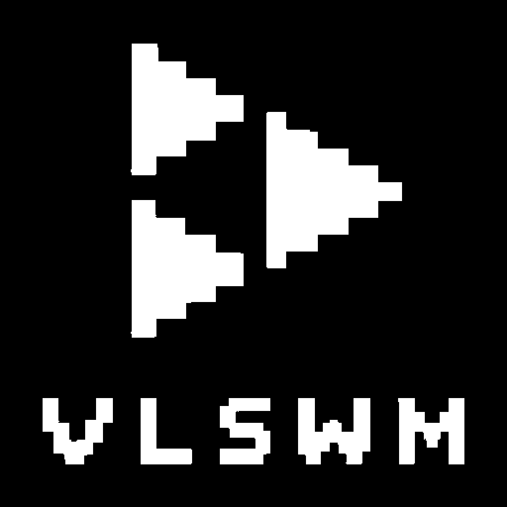

# vlswmplayer для iOS

[English](README.md) | Русский

Привет, я **Vlad175cm**. Это iOS-порт моего десктопного плеера
[vlswmplayer](https://github.com/Vlad175cm/vlswmplayer), которым я пользуюсь
внутри [VLSWM](https://github.com/Vlad175cm/VLSWM) — минимального
чёрно-белого шелла на Wayland.

На телефоне та же идея: поиск в SoundCloud без аккаунта, тап по треку,
слушаешь. Только чёрный и белый, только прямые углы, один моноширинный шрифт.
Никаких сторонних библиотек: SwiftUI и AVPlayer.



## Что умеет

- **Поиск** по SoundCloud через публичный `api-v2`, без входа.
- **Играет HLS напрямую** через `AVPlayer`, без загрузки перед стартом.
- **Кеширует прослушанное.** Первый раз трек играет и качается в фоне,
  следующий запуск идёт с диска примерно за секунду.
- **Лайки** в отдельной вкладке, лежат локально в `Documents/likes.json`.
- **Полноэкранный плеер**: тап по обложке — обложка, название, исполнитель,
  длительность, перемотка и кнопки лайка, предыдущего, паузы и следующего.
- DRM-треки пропускаются, а не вешают экран.

## Требования

- iOS 15 или новее, устройство arm64
- Собрано в Xcode 16 / SDK iOS 17, минимальная версия iOS 15

## Установка

### TrollStore (джейлбрейк, рекомендую)

TrollStore ставит неподписанные IPA навсегда: без Apple ID, без сертификата,
без переподписи раз в 7 дней. Открой `.ipa` в TrollStore и нажми Install.

Совместимость: iOS 14.0–15.4.1 на arm64, до 16.6.1 (и 17.0 на arm64e).
Сверься с документацией TrollStore для своей модели и версии.

### AppSync Unified (джейлбрейк, любая iOS 15+)

Если TrollStore не поддерживает твою прошивку — например iPhone 7 на
iOS 15.8.7 — используй AppSync Unified:

1. Поставь **AppSync Unified** (rootless-сборку) из репозитория Karen's Repo.
2. Скинь `.ipa` на телефон и открой в Filza, либо из терминала:
   `appinst VLSWMPlayer.ipa`.

### Sideloadly (без джейлбрейка)

Sideloadly подписывает IPA бесплатным Apple ID и ставит по USB.
Сначала включи режим разработчика (`Настройки → Конфиденциальность и
безопасность → Режим разработчика`), потом доверься сертификату в
`Настройки → Основные → VPN и управление устройством`.
Через 7 дней приложение перестанет запускаться, нужно переподписать.

## Управление

- Тап по строке — играть трек.
- Тап по обложке в нижней панели — полноэкранный плеер.
- `|<` / `>|` — предыдущий / следующий трек.
- Средняя кнопка — пауза и продолжение.
- Перетаскивание полосы под обложкой — перемотка.
- `VOL` — громкость приложения.
- `+` / `*` — поставить или снять лайк у текущего трека.
- Вкладки `SEARCH` / `LIKES`, `*` помечает лайкнутые.
- Свайп вниз или `X` закрывают полноэкранный плеер.

## Файлы на устройстве

| Путь | Что внутри |
| --- | --- |
| `Documents/tracks/` | кеш аудио, один файл на трек |
| `Documents/likes.json` | лайкнутые треки |
| `Documents/vlswmplayer.log` | лог: поиск, резолв, воспроизведение, кеш |

Лог — первое, что стоит смотреть, если трек не играет. Найти его можно так:

```bash
find /var/mobile/Containers/Data/Application -name vlswmplayer.log 2>/dev/null
```

## Как это работает

- Поиск: `GET https://api-v2.soundcloud.com/search/tracks` с `client_id`,
  вшитым в бандл. На `401` приложение перезагружает `soundcloud.com`,
  вытаскивает свежий идентификатор из JS-бандла и повторяет запрос.
- Воспроизведение: запись из `media.transcodings` резолвится в прямой HLS-URL
  и отдаётся `AVPlayer`. Треки `*-encrypted-hls` отсеиваются ещё при поиске.
- Кеш: тот же URL скачивается в фоне в `Documents/tracks/<id>.<ext>`,
  расширение выбирается по заголовку файла (`ftyp` → `.m4a`, `ID3` → `.mp3`,
  `OggS` → `.ogg`). HLS сохраняется одним склеенным файлом.
- Лайки: обычный JSON, без аккаунта, никуда не отправляется.

## Сборка

IPA собирается в GitHub Actions на macOS-раннере
(`.github/workflows/build.yml`). Пуш тега `v*` собирает IPA и сам прикрепляет
его к релизу.

Локально (macOS с Xcode):

```bash
brew install xcodegen ldid
xcodegen generate
xcodebuild -project VLSWMPlayer.xcodeproj -scheme VLSWMPlayer \
  -sdk iphoneos -configuration Release CODE_SIGNING_ALLOWED=NO
```

Упаковка:

```bash
mkdir Payload
cp -R build/Build/Products/Release-iphoneos/VLSWMPlayer.app Payload/
ldid -S"$PWD/entitlements.plist" Payload/VLSWMPlayer.app/VLSWMPlayer
zip -qry VLSWMPlayer.ipa Payload
```

## Замечания

- Публичные эндпоинты SoundCloud — не официальное API. Они могут меняться,
  `client_id` может протухнуть.
- Плеер не трогает твой аккаунт SoundCloud: входа нет, лайки остаются локально.
- Приложение намеренно неподписанное — именно поэтому работают TrollStore и
  AppSync.

## Лицензия

[MIT](LICENSE). Вшитый шрифт JetBrains Mono распространяется по
[SIL Open Font License 1.1](https://github.com/JetBrains/JetBrainsMono/blob/master/OFL.txt).
